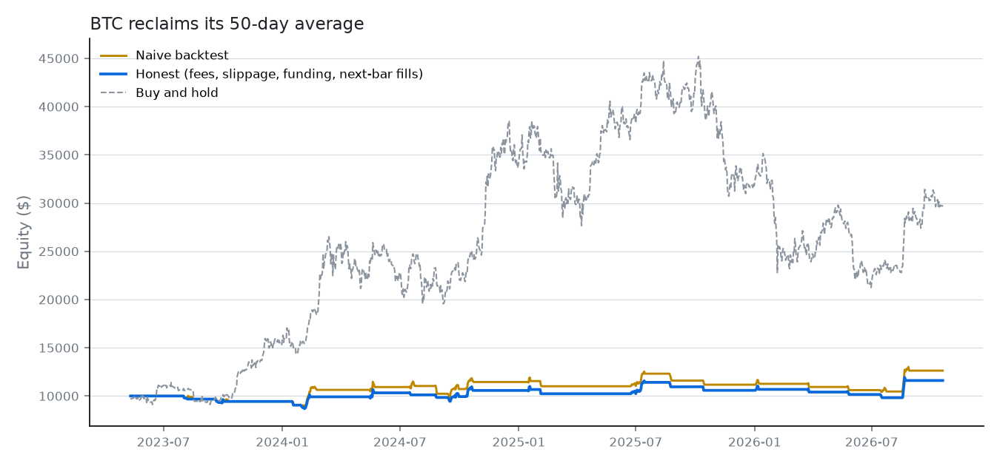

# BTC reclaims its 50-day average

> Buy BTC when it reclaims its 50-day average on rising volume. Exit on a 4% trailing stop.

**BTC-PERP on Hyperliquid**, 1d bars, 2023-05-11 to 2026-10-19, $10,000 start, long, 1x leverage. Data: Hyperliquid candles and hourly funding.

**Compiled rules**

- Enter long when all hold: `close crosses_above sma(50)`; `volume > volume_sma(20)`
- Trailing stop 4%
- Guardrails: max position $50,000, max leverage 3x, daily loss limit 10%

## Where it breaks

- Only 22 trades: too few to tell skill from luck; one trade can flip the result.
- A naive backtest overstates the return by 10.2 points.
- Profit comes from one market regime and is given back in the others.
- Buying and holding returned 196.5% over the same period.

## Results

| Run | Return | Max drawdown | Sharpe | Trades | Win rate | Fees | Funding paid | Liquidations | Entries blocked |
|---|---|---|---|---|---|---|---|---|---|
| Naive | +26.3% | -16.9% | 0.55 | 20 | 50% | $0 | $0 | 0 | 0 |
| Honest | +16.1% | -15.1% | 0.41 | 22 | 41% | $200 | $343 | 0 | 0 |
| Honest, fees ×2 and slippage ×3 | +11.8% | -16.1% | 0.32 | 22 | 41% | $393 | $337 | 0 | 0 |

Buy and hold over the same period: +196.5%.

## Time split and regimes

- Before 2025-10-07 (first 70% of bars): +9.5% over 16 trades. After: +9.6% over 5 trades.
- P&L by BTC's trailing 30-day trend: uptrend $2,550, sideways $-901, downtrend $-43. The coin trended up 27% of the time and down 14%.

## Nearby settings

Each setting nudged on its own, everything else unchanged (honest costs).

| Setting | Changed to | Return |
|---|---|---|
| sma(50) = 50 | 37.5 | +20.0% |
| sma(50) = 50 | 45 | +32.9% |
| sma(50) = 50 | 55 | +25.4% |
| sma(50) = 50 | 62.5 | +37.5% |
| volume_sma(20) = 20 | 15 | +21.2% |
| volume_sma(20) = 20 | 18 | +13.6% |
| volume_sma(20) = 20 | 22 | +16.1% |
| volume_sma(20) = 20 | 25 | +9.1% |
| trailing_stop_pct = 4 | 3 | +26.2% |
| trailing_stop_pct = 4 | 3.6 | +24.4% |
| trailing_stop_pct = 4 | 4.4 | +6.6% |
| trailing_stop_pct = 4 | 5 | +2.7% |
