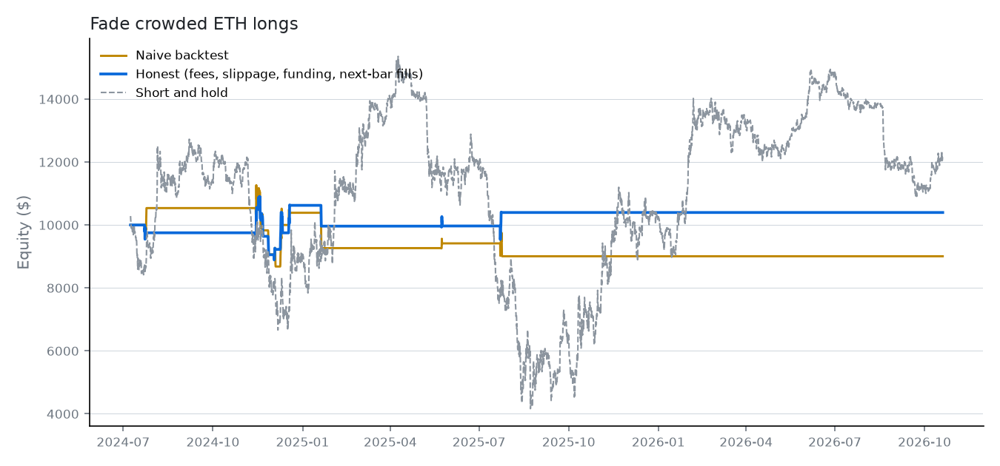

# Fade crowded ETH longs

> Short ETH when longs are crowded: funding above 0.03% per 8 hours and price below its 20-period EMA. Exit after a day or on a 3% stop.

**ETH-PERP on Hyperliquid**, 4h bars, 2024-07-08 to 2026-10-19, $10,000 start, short, 2x leverage. Data: Hyperliquid candles and hourly funding.

**Compiled rules**

- Enter short when all hold: `funding_8h > 0.0003`; `close < ema(20)`
- Stop loss 3%
- Exit after 6 bars
- Guardrails: max position $50,000, max leverage 3x, daily loss limit 6%, cooldown 2 bars

## Where it breaks

- Only 14 trades: too few to tell skill from luck; one trade can flip the result.
- Funding paid the strategy $190; part of the edge is carry, not price.
- Fragile: 50% of nearby parameter settings flip the result's sign.
- No trades after 2026-02-11: the setup stopped occurring.
- Profit comes from one market regime and is given back in the others.

## Results

| Run | Return | Max drawdown | Sharpe | Trades | Win rate | Fees | Funding paid | Liquidations | Entries blocked |
|---|---|---|---|---|---|---|---|---|---|
| Naive | -9.9% | -22.9% | -0.20 | 17 | 59% | $0 | $0 | 0 | 4 |
| Honest | +4.0% | -18.5% | 0.19 | 14 | 57% | $252 | $-190 | 0 | 5 |
| Honest, fees ×2 and slippage ×3 | +11.1% | -19.7% | 0.38 | 15 | 53% | $581 | $-197 | 0 | 6 |

Short and hold over the same period: +21.7%.

## Time split and regimes

- Before 2026-02-11 (first 70% of bars): +4.0% over 14 trades. After: +0.0% over 0 trades.
- P&L by ETH's trailing 30-day trend: uptrend $1,305, sideways $-908, downtrend $0. The coin trended up 26% of the time and down 30%.

## Nearby settings

Each setting nudged on its own, everything else unchanged (honest costs).

| Setting | Changed to | Return |
|---|---|---|
| ema(20) = 20 | 15 | -18.8% |
| ema(20) = 20 | 18 | +4.0% |
| ema(20) = 20 | 22 | +8.0% |
| ema(20) = 20 | 25 | -15.7% |
| stop_loss_pct = 3 | 2.25 | -2.2% |
| stop_loss_pct = 3 | 2.7 | +6.2% |
| stop_loss_pct = 3 | 3.3 | +0.7% |
| stop_loss_pct = 3 | 3.75 | -4.0% |
