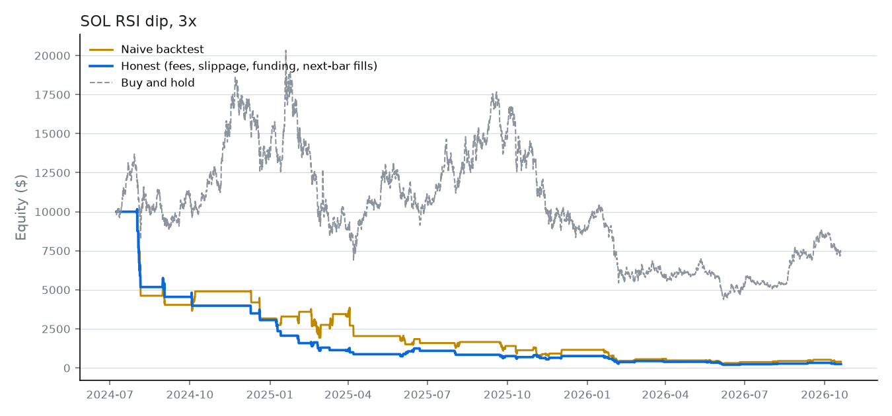

# SOL RSI dip, 3x

> Buy SOL with 3x leverage when the 4-hour RSI drops below 30. Take profit at 6%, stop at 4%. Don't enter if longs are paying more than 0.05% per 8 hours.

**SOL-PERP on Hyperliquid**, 4h bars, 2024-07-08 to 2026-10-19, $10,000 start, long, 3x leverage. Data: Hyperliquid candles and hourly funding.

**Compiled rules**

- Enter long when all hold: `rsi(14) < 30`
- Stop loss 4%
- Take profit 6%
- Guardrails: max position $50,000, max leverage 3x, daily loss limit 8%, no entry paying over 0.050%/8h funding

## Where it breaks

- Loses 97.5% after costs; 48 of 64 trades ended at the stop.
- Buying and holding returned -26.2% over the same period.

## Results

| Run | Return | Max drawdown | Sharpe | Trades | Win rate | Fees | Funding paid | Liquidations | Entries blocked |
|---|---|---|---|---|---|---|---|---|---|
| Naive | -96.0% | -97.6% | -0.99 | 57 | 33% | $0 | $0 | 0 | 70 |
| Honest | -97.5% | -98.0% | -1.85 | 64 | 25% | $275 | $2 | 0 | 92 |
| Honest, fees ×2 and slippage ×3 | -98.1% | -98.4% | -1.97 | 64 | 25% | $522 | $3 | 0 | 92 |

Buy and hold over the same period: -26.2%.

## Time split and regimes

- Before 2026-02-11 (first 70% of bars): -96.3% over 52 trades. After: -33.3% over 12 trades.
- P&L by SOL's trailing 30-day trend: uptrend $42, sideways $-6,863, downtrend $-2,930. The coin trended up 30% of the time and down 29%.

## Nearby settings

Each setting nudged on its own, everything else unchanged (honest costs).

| Setting | Changed to | Return |
|---|---|---|
| rsi(14) = 14 | 10.5 | -98.2% |
| rsi(14) = 14 | 12.6 | -98.1% |
| rsi(14) = 14 | 15.4 | -98.1% |
| rsi(14) = 14 | 17.5 | -93.1% |
| stop_loss_pct = 4 | 3 | -96.1% |
| stop_loss_pct = 4 | 3.6 | -96.2% |
| stop_loss_pct = 4 | 4.4 | -97.6% |
| stop_loss_pct = 4 | 5 | -96.6% |
| take_profit_pct = 6 | 4.5 | -98.3% |
| take_profit_pct = 6 | 5.4 | -97.4% |
| take_profit_pct = 6 | 6.6 | -98.6% |
| take_profit_pct = 6 | 7.5 | -98.4% |
